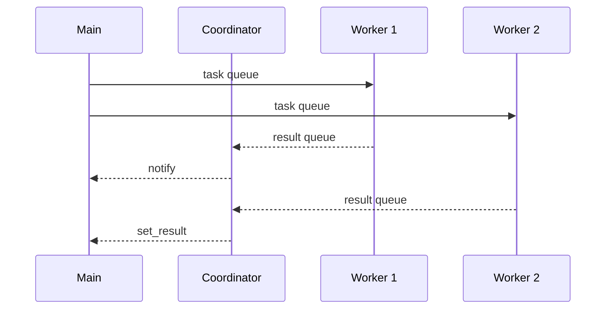

# Runner
Runner code is a different implementation compared to InterpreterPoolExecutor, however realistically it offers no real advantage over it. It is kept as a reference for others implementing custom `Executors` looking for inspiration.


## Basic Usage

Suppose you want ot run some CPU bound function in parallel.

Create a `Runner` and call the function in parallel using asyncio's `gather` or `TaskGroup`:
```py
with Runner(workers=5).start() as runner:
    await asyncio.gather(runner.run(cpu_bound_function, 5), runner.run(cpu_bound_function, 5))
```

### Restrictions
The CPU bound function must be importable and a top level function. All its arguments and return value must be [`Shareable`](https://github.com/Jamie-Chang/aiointerpreters/blob/main/src/aiointerpreters/types.py):

```py
type Shareable = (
    str | bytes | int | float | bool | None | tuple[Shareable, ...] | Queue | memoryview
)
```

## Architecture
We must run the interpreters in threads to achieve parallelism. In order to notify futures in the background we must also have a coordniator thread to handle the results.


